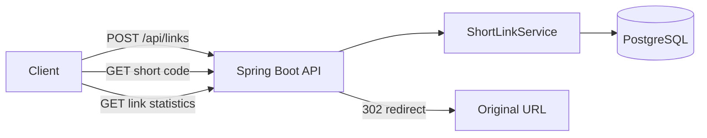

# ShortLink Analytics

A small Java and Spring Boot backend that turns long URLs into short links and counts redirects. It is designed to be straightforward to run and to explain in a software developer interview.

## What it does

1. Accepts a destination URL and creates an eight-character short code.
2. Saves the code, destination, creation time, and click count in PostgreSQL.
3. Redirects visitors to the destination when they open the short link.
4. Provides an endpoint to view the link's total clicks and last-clicked time.



## Requirements

- JDK 17 or newer
- Maven 3.6.3 or newer
- Docker Desktop, for the local PostgreSQL database

Spring Boot 3.5.16 is configured for Java 17. The database schema is created by the Flyway migration in `src/main/resources/db/migration`.

## Run locally on Windows

Open PowerShell in this project folder.

1. Start PostgreSQL:

   ```powershell
   docker compose up -d db
   ```

2. Start the API:

   ```powershell
   mvn spring-boot:run
   ```

The API listens on `http://localhost:8080`. To stop PostgreSQL later, run `docker compose down`. To remove the local database data too, run `docker compose down -v`.

The local database username, password, and database name are all `shortlinks`. These are demo credentials; change them before deploying anywhere public.

## Try the API

Create a short link:

```powershell
$body = @{ url = "https://spring.io/projects/spring-boot" } | ConvertTo-Json
$link = Invoke-RestMethod -Method Post -Uri "http://localhost:8080/api/links" -ContentType "application/json" -Body $body
$link
```

Open the returned `shortUrl` in a browser. The API responds with a `302 Found` redirect to the original URL.

Read analytics:

```powershell
Invoke-RestMethod -Uri "http://localhost:8080/api/links/$($link.code)/stats"
```

The response includes `clickCount` and `lastClickedAt`. `clickCount` increases each time the short link is opened.

## API reference

| Method | Endpoint | Purpose |
| --- | --- | --- |
| `POST` | `/api/links` | Create a short link. Body: `{"url":"https://example.com/page"}` |
| `GET` | `/{code}` | Record a click and redirect to the original URL |
| `GET` | `/api/links/{code}/stats` | Read the link and its click statistics |

The create endpoint accepts absolute `http` and `https` URLs. Invalid URLs and unknown codes return a JSON error with an appropriate HTTP status.

## Where to start reading the code

- `api/LinkController.java` handles link creation and analytics requests.
- `api/RedirectController.java` handles short-link visits and redirects.
- `service/ShortLinkService.java` contains the main rules: URL validation, code generation, and click recording.
- `domain/ShortLink.java` represents a saved link.
- `repository/ShortLinkRepository.java` contains the database queries.
- `db/migration/V1__create_short_links.sql` defines the table.

## Concepts to learn

1. Follow one create request from controller to service to repository.
2. Learn how a JPA entity maps to the `short_links` table.
3. Compare the create response with the `302 Found` redirect response.
4. Look at `recordClick` in the repository: the database increments the count in one update, so simultaneous visits do not overwrite each other's increments.
5. Read the Flyway migration and compare each SQL column with the fields in `ShortLink`.

## Current scope

This is a learning project, not a public production service. It has no user accounts or access control, and anyone who knows a code can read its statistics. Click analytics store a total and the most recent click time; they do not store visitor IP addresses or a per-day event history.
